# Such A Good Clock

A fullscreen clock for a spare monitor, a desk or a focused work session. Use it in the browser or install the Electron desktop app on macOS, Windows or Linux.

[](https://nazmiefearmutcu.github.io/such-a-good-clock/)
[](https://github.com/nazmiefearmutcu/such-a-good-clock/releases)
[](LICENSE)
[](https://github.com/nazmiefearmutcu/such-a-good-clock/actions/workflows/desktop-build.yml)
[](https://github.com/nazmiefearmutcu/such-a-good-clock/stargazers)

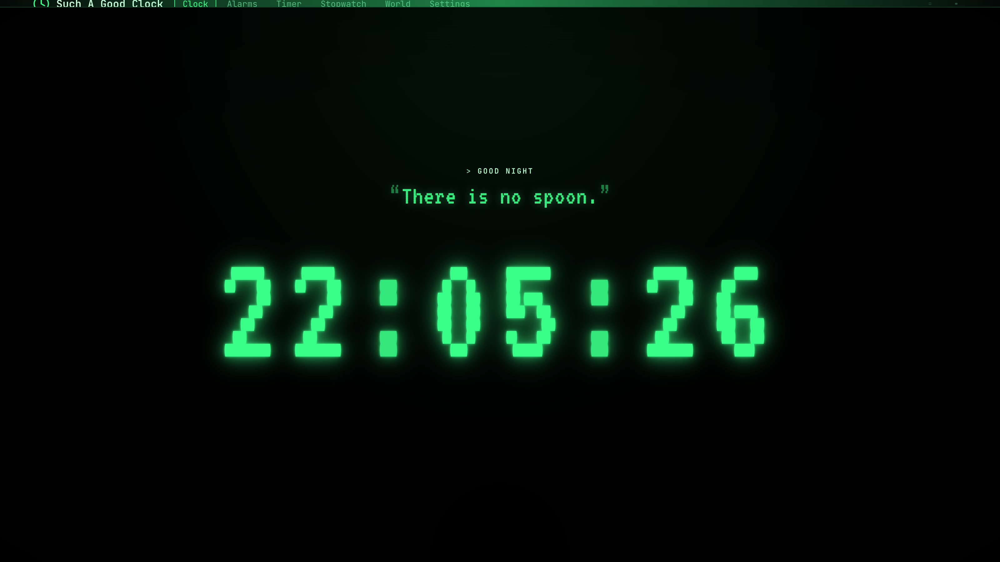

## Open or download

<p align="left">
  <a href="https://github.com/nazmiefearmutcu/such-a-good-clock/releases/latest/download/Such.A.Good.Clock-2.0.1-arm64.dmg">
    
  </a>
  &nbsp;
  <a href="https://github.com/nazmiefearmutcu/such-a-good-clock/releases/latest/download/Such.A.Good.Clock.Setup.2.0.1.exe">
    
  </a>
  &nbsp;
  <a href="https://nazmiefearmutcu.github.io/such-a-good-clock/">
    
  </a>
</p>

Linux packages, Windows portable builds and alternative archives are available on the [releases page](https://github.com/nazmiefearmutcu/such-a-good-clock/releases/latest). The macOS build is unsigned; macOS may require an explicit Open action on first launch.

## What it does

| Tool | Controls |
| --- | --- |
| Clock | Digital, analog or flip face; 12/24-hour time, date formats, fullscreen and world clocks using IANA timezones. |
| Alarms | Daily, weekday, weekend or one-time schedules, labels, six alert sounds and five-minute snooze. |
| Timer | Countdown presets and a Pomodoro cycle with configurable work sessions, breaks and rounds. |
| Stopwatch | Laps, split comparisons and CSV export. |
| Appearance | Eleven themes, three layouts, font scales, accent colors, animated backgrounds and optional CRT or grain effects. |
| Audio | Synthesized alerts and rain, space, fan, café or forest ambience with separate volume controls. |

Settings, alarms, world clocks and Pomodoro configuration are saved in the browser's localStorage. The app has no account system or application backend.

## Run from source

Use **Node.js 24** and npm, matching the desktop build workflow.

```bash
git clone https://github.com/nazmiefearmutcu/such-a-good-clock.git
cd such-a-good-clock
npm ci
npm run dev
```

Vite prints the local development URL, usually `http://localhost:5173`. Build and preview the static app with:

```bash
npm run build
npm run serve
```

The production bundle is written to `dist/`. In a supported browser, the web manifest enables installation and the service worker caches the app shell for subsequent offline use. The initial load needs a connection; Google Fonts may be unavailable offline until cached.

## Architecture

The browser and desktop editions share one UI and one state model:

```text
index.html → src/app.js → UI + state + audio + effects
                      ↓
              Vite bundle in dist/
                      ↓
          browser/PWA or Electron window
```

| Module | Responsibility |
| --- | --- |
| `src/app.js` | Initializes the app, starts the clock loop and registers the service worker. |
| `src/ui.js` / `src/dom.js` | Renders tools, binds controls and keyboard events, and checks alarm/timer deadlines. |
| `src/state.js` | Validates settings and persists them in localStorage. |
| `src/audio.js` / `src/fx.js` | Generates Web Audio sounds and Canvas background effects. |
| `public/sw.js` | Caches the web app shell and handles offline fallback. |
| `desktop/main.cjs` | Loads the compiled app in an Electron window with sandboxing and context isolation. |

Audio starts after browser permission or a user gesture. Alarms and timers run inside the open app; closing it or suspending the device interrupts scheduling. A saved countdown reloads paused. World clocks use the device clock and timezone data.

## Keyboard controls

| Key | Action |
| --- | --- |
| `Space` | Start or pause the timer/stopwatch |
| `R` / `L` | Reset / record a stopwatch lap |
| `F` | Toggle fullscreen |
| `1`–`6` | Switch tools |
| `←` / `→` | Switch themes |
| `Esc` | Stop an alert or close a dialog |
| `?` | Open the shortcut panel |

## Desktop builds

```bash
npm run desktop:run
npm run desktop:build:mac
npm run desktop:build:win
npm run desktop:build:linux
```

Run the matching build on its target operating system. Packages are written to `dist-native/`; [GitHub Actions](.github/workflows/desktop-build.yml) builds all three platforms and attaches artifacts to tagged releases.

## Screenshots

<details>
<summary>All themes, clock faces and tools</summary>


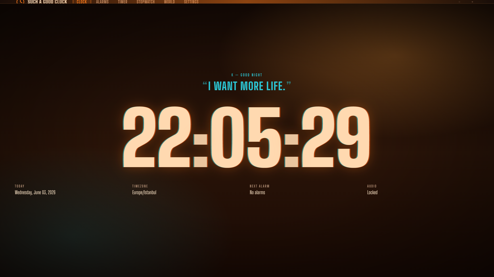

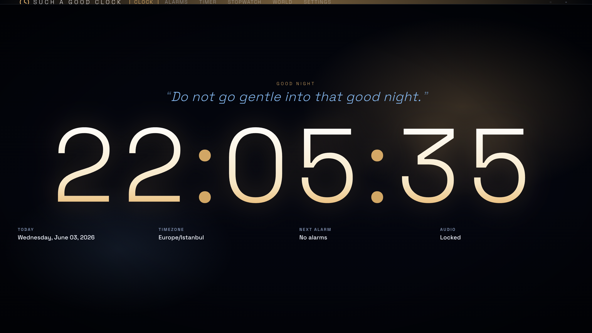

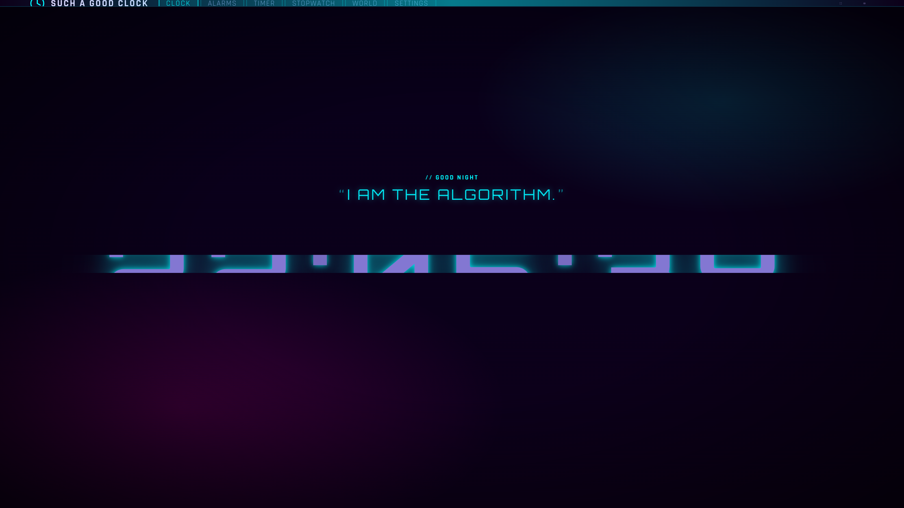

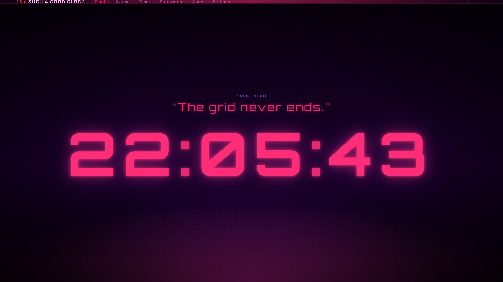

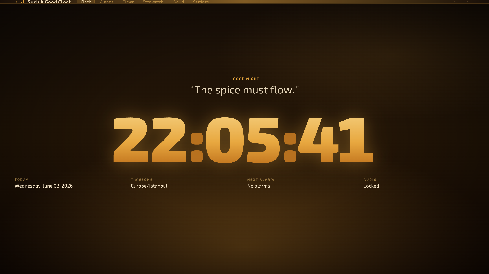

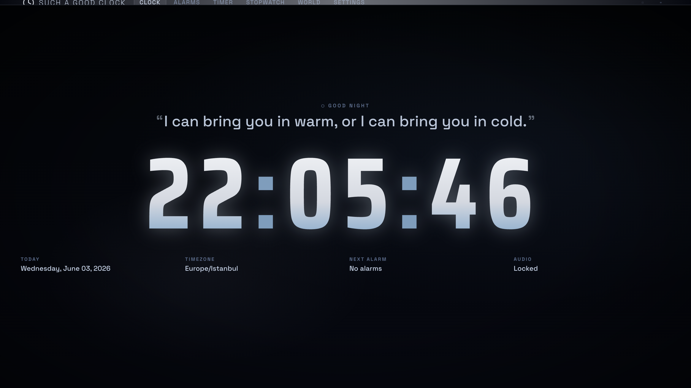

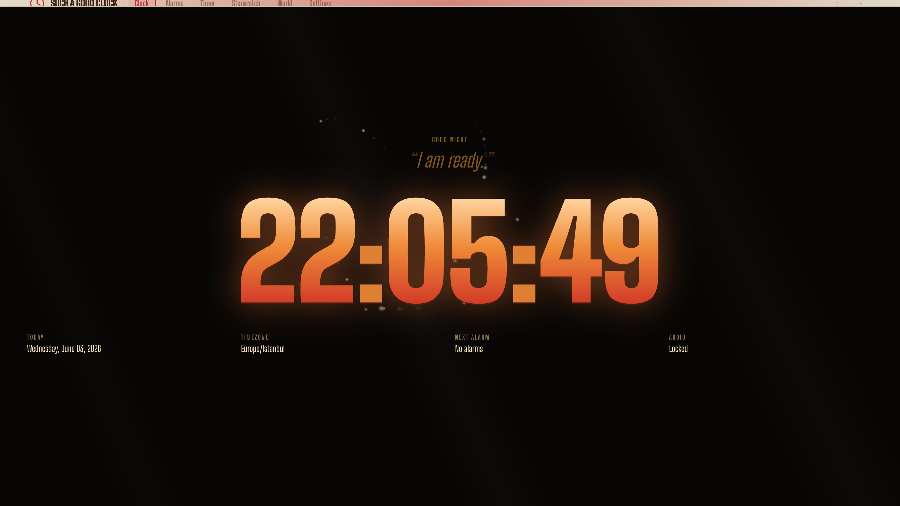

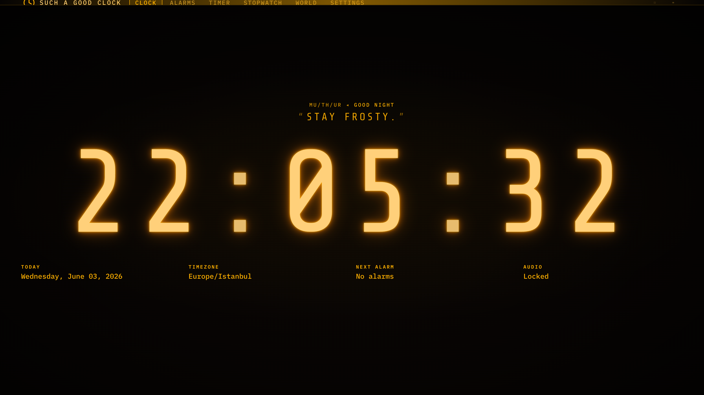

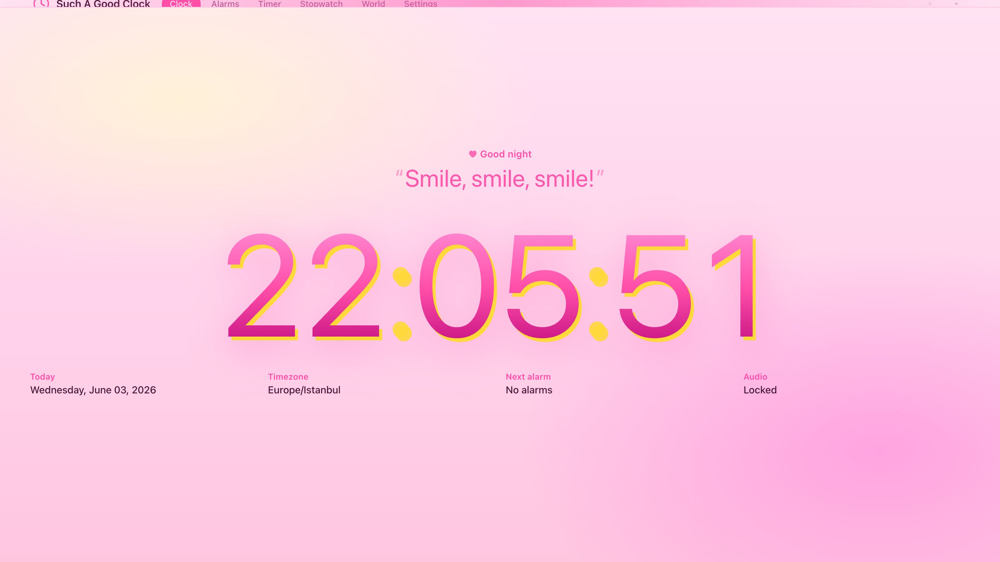

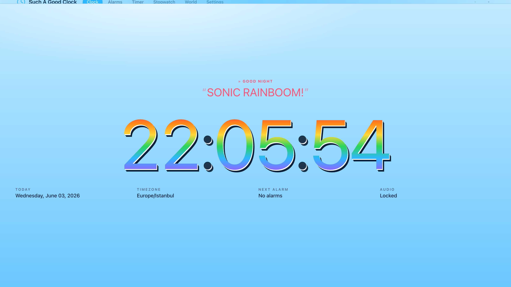

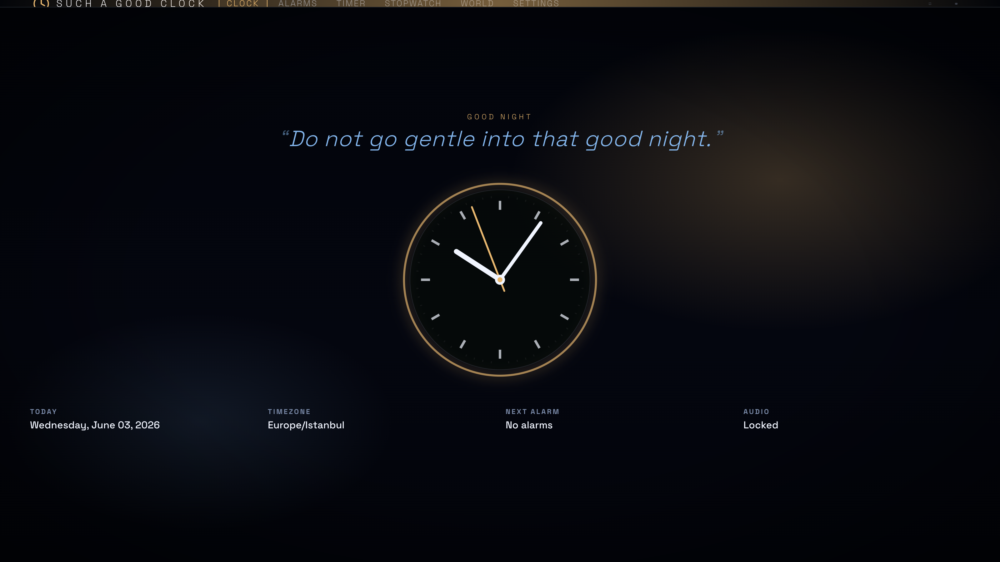

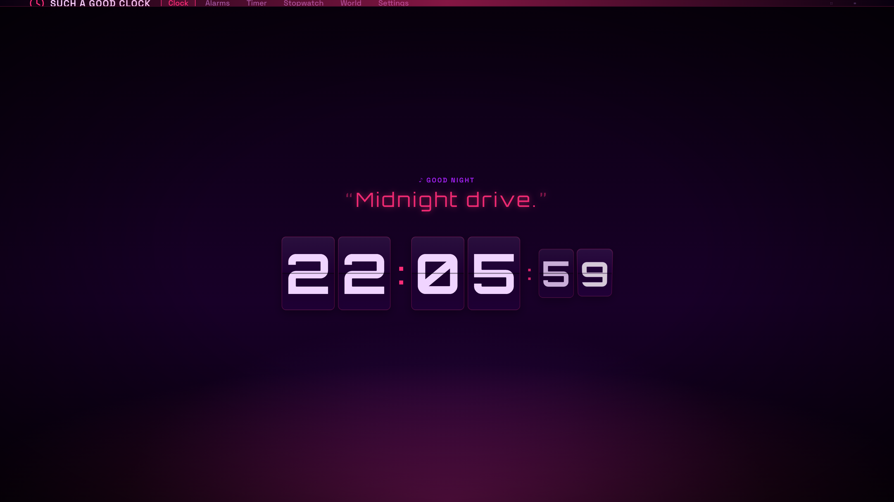

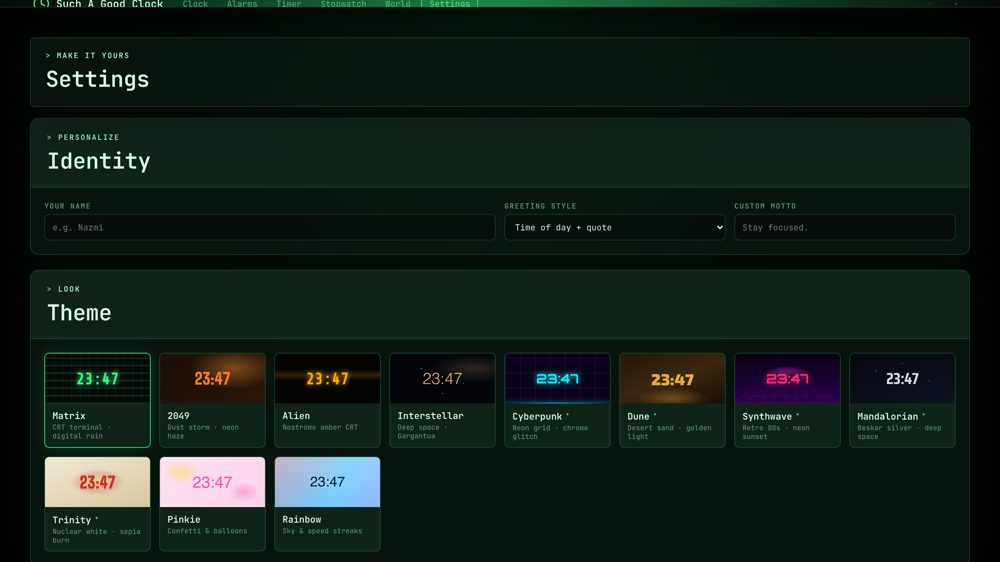

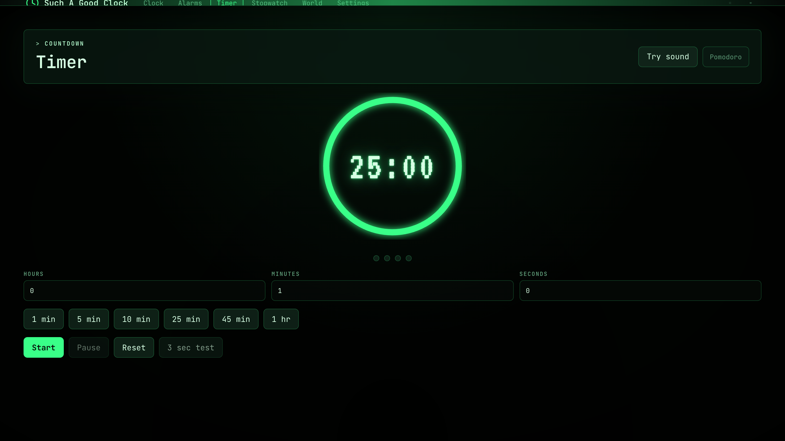

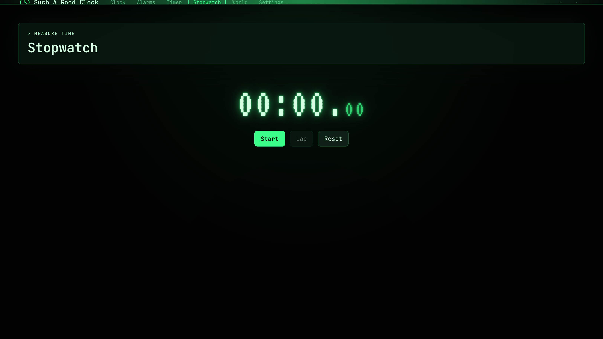

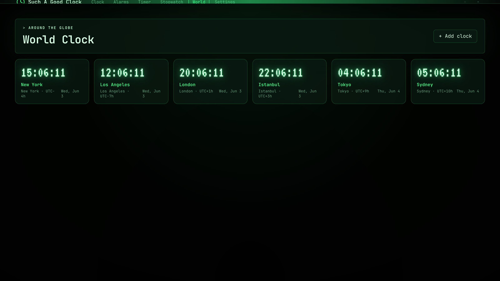

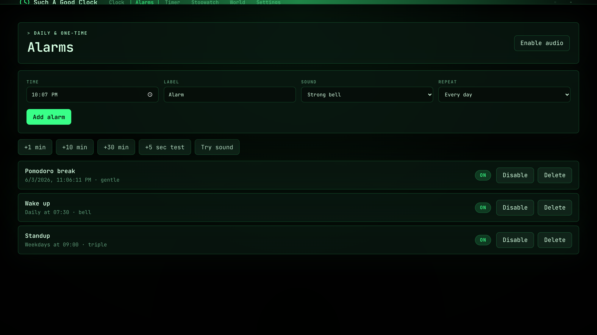

</details>

## Development

The [Playwright smoke harness](scripts/e2e.mjs) covers the ticking clock, storage recovery, PWA/offline behavior, alarms and timer audio. On macOS/Linux:

```bash
npx playwright install chromium
npm run test:e2e
```

On PowerShell, build first and set the test root explicitly:

```powershell
npm run build
npx playwright install chromium
$env:ROOT = 'dist'
node scripts/e2e.mjs
```

See [TEST_PLAN.md](TEST_PLAN.md), [CONTRIBUTING.md](CONTRIBUTING.md) and [SECURITY.md](SECURITY.md) for further guidance.

## License

[MIT](LICENSE).

Created By Nazmi Efe Armutcu (Aylin)
